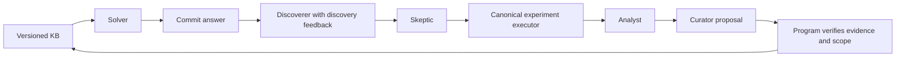

# Bounded knowledge workflow

`tools/kb_workflow.py` prepares, executes, and reports a bounded sequence of
architecture-learning rounds. The solver commits a prediction from public
question data. The discoverer then sees discovery feedback and proposes a
falsifiable claim. A skeptic challenges it, controlled experiments test an
accepted proposal, an analyst interprets the machine-scored evidence, and a
curator proposes a KB update. The store independently decides whether the
scientific evidence allows that update.

Ground truth follows the existing pipeline: frozen spec → generated code →
execution → stored metrics. Experiment planning and GT execution reuse the
canonical dataset and candidate generation paths. Model-authored claims,
explanations, and curator decisions cannot substitute for executed evidence.



## Inputs and isolation

Use a dedicated output directory under this checkout's `data/`. Public question
records have this shape:

```json
{
  "id": "question-id",
  "family": "univariate_regression",
  "dataset_id": "dataset-id",
  "lineage_id": "shared-original-and-counterfactual-lineage",
  "prompt": "The complete public benchmark prompt",
  "choices": [
    {"id": "candidate-id", "letter": "A", "view": {"family": "univariate_regression"}}
  ]
}
```

Pass a list of these records in `--public`. Each actual record must contain the
complete choice set and public candidate views. Bind dataset identity to the
outer question's `family` and `datasetId`; embedded candidate specs may carry
stale dataset IDs. Preserve original/counterfactual lineage so a related example
cannot cross discovery and evaluation boundaries. For verified-claim retrieval,
include the question's `profile_hash` from its public generation metadata and
build each candidate view with `architecture_iq.kb.rules.public_views` from the
bound public dataset spec and candidate specs. This supplies `loss_key` from
the actual public loss spec. A missing `profile_hash` or `loss_key` makes
verified-claim retrieval abstain. Preserve that abstention when source metadata
is unavailable; do not infer a hash from a profile name or guess missing loss
controls. Records may specify `split`
as `discovery`, `development`, or `final`; omitted splits are discovery.

`--private` is a separate JSON object mapping question IDs to feedback, including
`correct_letter` and optional `candidate_metrics`. Keep labels, curves, and GT
out of public records. The solver receives public data and applicable KB notes;
discovery feedback becomes available only after its prediction is recorded.
Historical release examples can teach discovery. They do not establish fresh
experimental confirmation.

Later rounds give the discoverer a bounded research agenda and observations
from completed earlier rounds, including negative results whose curator chose
no KB update. These records arrive only after the current answers are committed
and are never injected into the solver as verified knowledge. Published claims
can acquire a new revision; unpublished proposals can inform a new hypothesis
without pretending that their IDs already exist in the KB. Older optional
observations are omitted first when the fixed context budget is tight.

Evidence summaries include a verified example's actual model differences,
optimizer/loss/budget controls, dataset parameters, seed counts, and stored GT
statistics. Independent dataset counts are reported separately from training
seed counts. These facts are read from hash-bound experiment artifacts;
pre-experiment conjectures are not observations. Role explanations still need
inspection, and cannot override the deterministic evidence outcome.

An optional `--legacy` input accepts either a list of claims or an old KB object
with a `claims` list. Historical claims enter as disabled `legacy_unverified`
records. Their previous scores do not establish scientific authority. Add
`--legacy-rules PATH` with `--legacy` to import an existing compiled rule document.
The importer joins rules by source claim ID and splits multi-clause claims into
`ID.clause-1`, `ID.clause-2`, and so on, retaining source IDs and clause indices.
All imported clauses remain disabled and unverified. For the archived 294-claim
KB and its compiled rules, this produces 299 imported records, 57 with rules.
Those counts describe that source snapshot, not a universal importer requirement.
`--legacy-rules` without `--legacy` is rejected before preparing any output.

## Runtime identity

The smoke configuration is
`configs/experiments/kb_workflow_glm53_smoke.json`. It preserves the established
GLM request settings, including an 8192-token output limit. Its
`runtime_fingerprint` is intentionally unset. Preparation rejects it until a
real runtime lock has been produced and its canonical JSON hash inserted into a
run-specific copy of the configuration.

A runtime lock must contain:

- `model_id`, `endpoint`, and the actual `model_path` reported by the service.
- `chat_template_sha256` and positive integer `context_size` from live `/props`.
- `model_parameters`, exactly matching the complete configuration's `model`.
- `file_verifications`: attested engine and weight records, each containing
  `path`, `sha256_from_attestation`, and `current_state` with `size`, `mtime_ns`,
  `ctime_ns`, `device`, and `inode`.
- `process_identity` for a fresh local service: `pid`, `/proc/PID/stat` start time
  in clock ticks as `start_ticks`, SHA256 of the raw `/proc/PID/cmdline` bytes as
  `cmdline_sha256`, and the `/proc/PID/exe` link target as `executable_path`.
  When included, every field must match the live process.

Include the actual startup arguments, engine version, binary/library hashes,
weight shard hashes, and GPU/CPU placement in the lock as additional fields.
All fields participate in its fingerprint. Full-file SHA256 attestations may be
reused only after current file metadata matches the attested metadata. A change
to engine, weights, template, placement, or startup configuration requires a
fresh lock and a new run. An archived lock alone does not establish that a live
service has the same identity.

The lock fingerprint uses finite UTF-8 JSON with sorted keys, no added whitespace,
and `ensure_ascii=False`. This example creates a run configuration after the
actual lock has been saved; substitute your existing paths:

```bash
PYTHONPATH=src python - <<'PY'
import json
from pathlib import Path
from architecture_iq.kb.store import canonical_hash
base = Path('data/kb_workflow_build')
lock = json.loads((base / 'runtime-lock.json').read_text())
config = json.loads(Path('configs/experiments/kb_workflow_glm53_smoke.json').read_text())
config['runtime_fingerprint'] = canonical_hash(lock)
(base / 'smoke_config.json').write_text(json.dumps(config, indent=2) + '\n')
PY
```

Every execution command checks the lock hash, current file metadata, process
identity when recorded, `/health`, `/v1/models`, and `/props`. The client exposes
the same check for the role caller before and after each network inference,
so a service restart or an identity change interrupts the run. It verifies the
model alias, weight path, chat template, context size, and configured decoding
defaults. Each response is also checked against the frozen model name. Model
calls use the existing `tools.llm_eval.llm_client.LLMClient` with timeout 900
seconds, zero automatic retries, and the local-only credential.

## Prepare and run the smoke workflow

Use the checkout's interpreter and establish import provenance before tests or
execution:

```bash
export PYTHONPATH="$PWD/src"
python -c 'import architecture_iq; print(architecture_iq.__file__)'
```

The printed path must be inside this checkout's `src/architecture_iq`.
Preparation and status are available locally and perform no inference or
training:

```bash
python tools/kb_workflow.py prepare \
  --config data/kb_workflow_build/smoke_config.json \
  --public data/kb_workflow_build/public_questions.json \
  --private data/kb_workflow_build/private_feedback.json \
  --runtime-lock data/kb_workflow_build/runtime-lock.json \
  --out data/kb_workflow_smoke

python tools/kb_workflow.py status --out data/kb_workflow_smoke
```

Run inference and training only on the designated Linux host. Execution requires
both the host declaration and `--execute`:

```bash
# Load matching ARCHITECTURE_IQ_KB_AUTHORIZED_HOST and
# ARCHITECTURE_IQ_KB_EXECUTION_HOST from private server configuration.
python tools/kb_workflow.py run \
  --out data/kb_workflow_smoke --round 1 --execute \
  --runtime-lock data/kb_workflow_build/runtime-lock.json \
  --base-url http://127.0.0.1:18054/v1
```

Use the endpoint in the actual lock. `--base-url` takes precedence over
`OPENAI_API_BASE`; the fallback is `http://127.0.0.1:18053/v1`. A mismatch with the
lock is rejected. The CLI does not start a model server or change GPU allocation.

The smoke run has two discovery questions, one round, one exploratory dataset
per accepted proposal, and two GT seeds per candidate. Discovery packets contain
one full question and its feedback at a time to fit the conservative context
budget. It caps candidate-seed
runs at 40, role calls at 30 per round, token usage at 250,000 per round, and
wall time at 3,600 seconds. A rejected or inapplicable hypothesis may produce no
experiment. Confirmation is disabled: a successful smoke run demonstrates the
workflow and its artifacts, and cannot establish a scientifically confirmed KB
claim or an evaluation improvement.

Prepared inputs are immutable. Completed operations can be replayed using their
recorded receipts; a pending or uncertain model call is not silently repeated.
Inspect status and the saved artifacts after an interrupted command before
choosing a new run. Do not edit frozen inputs or receipts to resume it.

## Confirmation and held-out evaluation

For a subsequent three-round study, create a separate configuration and output
directory with `max_rounds: 3`. Supply enough discovery records for all rounds
and distinct lineage groups for development and final evaluation. Increase
explicit call, token, wall-time, and candidate-seed budgets to cover the planned
work.

Enabling `enable_confirmation` requires a confirmation plan with
`confirmation_count: 48` independent datasets and `n_seeds: 10`. The confirmation
allocation must be frozen before its outcomes are observed, use fresh datasets
outside exploration, and satisfy the evidence/store checks. Exploration with a
few datasets or seeds remains exploratory even when every observed comparison
supports the claim. Scientific claim status is separate from downstream solver
accuracy.

Each plan freezes its dataset seeds and public candidate pairs before GT exists.
The adapter first generates controlled factor variants, enumerates all pairs
where the rule makes a prediction, and chooses uniformly using a separate seed
stream. Width uses the existing three sampled variants before this pair draw.
The plan records the selection strategy, eligible pair count and chosen variant
indexes. Inconclusive outcomes remain in the confirmation denominator; failed
execution never becomes supporting evidence.

A published `validated_scope` comes from verified experiment plans. Retrieval
intersects it with the authored rule and requires the same family and profile,
matching optimizer, loss, budget and batch size, and only the studied
architecture factor to vary. The uniform sampling result supports the stated
sampling population; it does not make the claim true for every individual pair.
The confirmation gate uses 48 independent datasets and a one-sided Hoeffding
bound with a three-attempt correction, plus a minimum observed support rate of
0.75. Development and final evaluation remain separate from scientific evidence.

Evaluate a prepared development or final split with:

```bash
python tools/kb_workflow.py evaluate \
  --out data/kb_workflow_study --phase development --execute \
  --runtime-lock data/kb_workflow_build/runtime-lock.json \
  --base-url http://127.0.0.1:18054/v1

python tools/kb_workflow.py evaluate \
  --out data/kb_workflow_study --phase final --execute \
  --runtime-lock data/kb_workflow_build/runtime-lock.json \
  --base-url http://127.0.0.1:18054/v1
```

Final evaluation requires the configured rounds to finish first. Keep final
feedback out of further discovery and revision. Report smoke completion,
experimental confirmation, and held-out performance as separate outcomes.

The [GLM smoke report](reports/kb-workflow-glm53-smoke-20261009.md) records the
first real five-role episode, its exploratory counterexample, and the unchanged
KB. It does not claim confirmation or held-out improvement.
